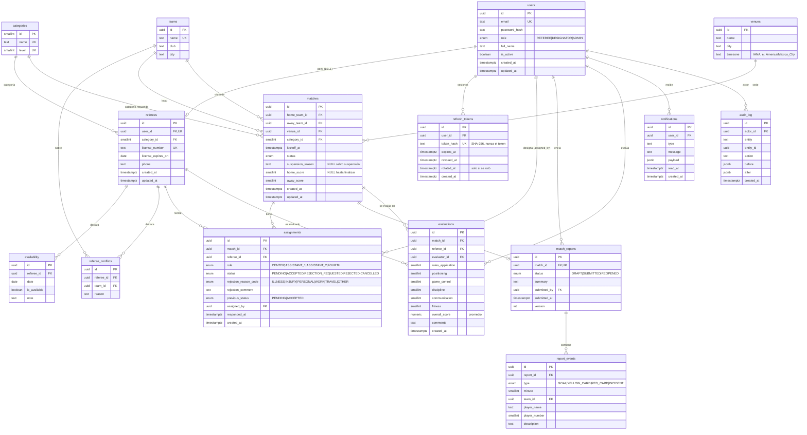

# Modelo de datos

PostgreSQL + Prisma. Todas las fechas/horas son `timestamptz` guardadas en **UTC**. `availability.date` y `referees.license_expires_on` son `date` (sin hora). IDs: `uuid` generados por la BD.

> Estado: **borrador v0.2**. Además de las 11 tablas pedidas agrego 4 que las reglas y la seguridad necesitan: `categories`, `referee_conflicts` (R4), `audit_log` (auditoría de informes/evaluaciones) y `refresh_tokens` (sesiones).

## Diagrama ER

## Tablas

### users
| Columna | Tipo | Restricciones |
|---|---|---|
| id | uuid | PK |
| email | text | NOT NULL, UNIQUE, CHECK (email = lower(email)) |
| password_hash | text | NOT NULL (argon2id) |
| role | enum | NOT NULL |
| full_name | text | NOT NULL, CHECK (length(trim(full_name)) > 0) |
| is_active | boolean | NOT NULL, default true |
| created_at / updated_at | timestamptz | NOT NULL |

Índice: `(role, is_active)`. La regla "siempre queda al menos un administrador activo" (`LAST_ADMIN`) vive en el servicio y se evalúa en una transacción serializable.

### refresh_tokens
| Columna | Tipo | Restricciones |
|---|---|---|
| id | uuid | PK |
| user_id | uuid | NOT NULL, FK → users ON DELETE CASCADE |
| token_hash | text | NOT NULL, UNIQUE (SHA-256 del token; el token en claro solo existe en la cookie) |
| expires_at | timestamptz | NOT NULL, CHECK (expires_at > created_at) |
| revoked_at | timestamptz | NULL; con valor, el token ya no sirve |
| rotated_at | timestamptz | NULL; solo se rellena al **rotar** (no al cerrar sesión ni al revocar por robo) |
| created_at | timestamptz | NOT NULL |

Índice: `(user_id, revoked_at)`. Los tokens se **rotan** en cada uso: el anterior queda revocado y se emite uno nuevo. Si se presenta un token ya revocado se asume robo y se revocan todas las sesiones del usuario, **salvo** que se haya rotado hace 10 segundos o menos (`rotated_at`): eso es casi seguro una carrera legítima (recarga rápida, dos pestañas, una navegación que perdió la cookie nueva) y se responde con un token nuevo sin cerrar nada. Al desactivar a un usuario también se revocan.

### categories
| Columna | Tipo | Restricciones |
|---|---|---|
| id | smallint | PK |
| name | text | NOT NULL, UNIQUE |
| level | smallint | NOT NULL, UNIQUE, CHECK (level > 0) |

Son datos de referencia: sus 4 filas (Regional, Nacional, Primera División, Internacional) se insertan en la migración, así existen en todos los ambientes. No están en el seed.

### referees
| Columna | Tipo | Restricciones |
|---|---|---|
| id | uuid | PK |
| user_id | uuid | NOT NULL, UNIQUE, FK → users (ON DELETE RESTRICT) |
| category_id | smallint | NOT NULL, FK → categories |
| license_number | text | NOT NULL, UNIQUE, CHECK (length(trim(license_number)) > 0) |
| license_expires_on | date | NOT NULL |
| phone | text | NULL |

Solo un `users.role = REFEREE` puede tener perfil (validado en el servicio). Índice: `(category_id)`. Una licencia sigue vigente todo el día de su vencimiento (R3).

### teams
| Columna | Tipo | Restricciones |
|---|---|---|
| id | uuid | PK |
| name | text | NOT NULL, UNIQUE, CHECK (length(trim(name)) > 0) |
| club | text | NOT NULL, CHECK (length(trim(club)) > 0) |
| city | text | NULL |

### venues
| Columna | Tipo | Restricciones |
|---|---|---|
| id | uuid | PK |
| name | text | NOT NULL |
| city | text | NOT NULL |
| timezone | text | NOT NULL (IANA) |
| | | UNIQUE (name, city) |

### matches
| Columna | Tipo | Restricciones |
|---|---|---|
| id | uuid | PK |
| home_team_id, away_team_id | uuid | NOT NULL, FK → teams; **CHECK (home_team_id <> away_team_id)** |
| venue_id | uuid | NOT NULL, FK → venues |
| category_id | smallint | NOT NULL, FK → categories |
| kickoff_at | timestamptz | NOT NULL |
| status | enum | NOT NULL, default `SCHEDULED` (incluye `SUSPENDED`) |
| suspension_reason | text | NULL; obligatorio si `status = SUSPENDED` (CHECK) |
| home_score, away_score | smallint | NULL, CHECK (>= 0), ambos NULL o ambos NOT NULL |

Índices: `(kickoff_at)`, `(status, kickoff_at)`, `(category_id)`.

### availability
| Columna | Tipo | Restricciones |
|---|---|---|
| id | uuid | PK |
| referee_id | uuid | NOT NULL, FK → referees ON DELETE CASCADE |
| date | date | NOT NULL |
| is_available | boolean | NOT NULL |
| note | text | NULL |
| | | **UNIQUE (referee_id, date)** |

### referee_conflicts
| Columna | Tipo | Restricciones |
|---|---|---|
| id | uuid | PK |
| referee_id | uuid | NOT NULL, FK → referees |
| team_id | uuid | NOT NULL, FK → teams |
| reason | text | NOT NULL, CHECK (length(trim(reason)) > 0); el servicio exige 10 caracteres como mínimo |
| | | UNIQUE (referee_id, team_id) |

Índice: `(team_id)`. `referee_id` borra en cascada; `team_id` no (un equipo con conflictos no se puede eliminar).

### assignments
| Columna | Tipo | Restricciones |
|---|---|---|
| id | uuid | PK |
| match_id | uuid | NOT NULL, FK → matches ON DELETE CASCADE |
| referee_id | uuid | NOT NULL, FK → referees |
| role | enum | NOT NULL |
| status | enum | NOT NULL, default `PENDING` |
| rejection_reason_code | enum | NULL; obligatorio si `status IN ('REJECTED','REJECTION_REQUESTED')` (CHECK) |
| rejection_comment | text | CHECK (status NOT IN ('REJECTED','REJECTION_REQUESTED') OR length(trim(rejection_comment)) >= 10) |
| previous_status | enum | NULL; estado al que vuelve si el admin deniega el rechazo (`PENDING` o `ACCEPTED`) |
| assigned_by | uuid | NOT NULL, FK → users |
| responded_at | timestamptz | NULL |

Restricciones clave, como **índices únicos parciales** (solo cuentan las asignaciones activas, `status IN ('PENDING','ACCEPTED','REJECTION_REQUESTED')`), para que un rol rechazado se pueda reasignar:

- `UNIQUE (match_id, role) WHERE status IN ('PENDING','ACCEPTED','REJECTION_REQUESTED')` → un solo árbitro por rol.
- `UNIQUE (match_id, referee_id) WHERE status IN ('PENDING','ACCEPTED','REJECTION_REQUESTED')` → un árbitro no ocupa dos roles.

Índice: `(referee_id, status)`.

> Prisma no soporta índices parciales en el esquema: van como SQL crudo en la migración.

### match_reports
| Columna | Tipo | Restricciones |
|---|---|---|
| id | uuid | PK |
| match_id | uuid | NOT NULL, **UNIQUE**, FK → matches |
| status | enum | NOT NULL, default `DRAFT` |
| summary | text | NULL |
| submitted_by | uuid | FK → users, NULL hasta enviar |
| submitted_at | timestamptz | CHECK (status <> 'SUBMITTED' OR submitted_at IS NOT NULL) |
| version | int | NOT NULL, default 1 (bloqueo optimista) |

### report_events
| Columna | Tipo | Restricciones |
|---|---|---|
| id | uuid | PK |
| report_id | uuid | NOT NULL, FK → match_reports ON DELETE CASCADE |
| type | enum | NOT NULL |
| minute | smallint | NOT NULL, CHECK (minute BETWEEN 0 AND 130) ⚠️ |
| team_id | uuid | FK → teams, NULL en `INCIDENT` |
| player_name | text | NULL |
| player_number | smallint | CHECK (BETWEEN 1 AND 99) |
| description | text | NULL; obligatorio si `type = INCIDENT` (CHECK) |

Índice: `(report_id, minute)`.

### evaluations
| Columna | Tipo | Restricciones |
|---|---|---|
| id | uuid | PK |
| match_id | uuid | NOT NULL, FK → matches |
| referee_id | uuid | NOT NULL, FK → referees |
| evaluator_id | uuid | NOT NULL, FK → users |
| rules_application | smallint | NOT NULL, CHECK (BETWEEN 1 AND 10) |
| positioning | smallint | NOT NULL, CHECK (BETWEEN 1 AND 10) |
| game_control | smallint | NOT NULL, CHECK (BETWEEN 1 AND 10) |
| discipline | smallint | NOT NULL, CHECK (BETWEEN 1 AND 10) |
| communication | smallint | NOT NULL, CHECK (BETWEEN 1 AND 10) |
| fitness | smallint | NOT NULL, CHECK (BETWEEN 1 AND 10) |
| overall_score | numeric(3,1) | NOT NULL; promedio de los 6 criterios, calculado en el servicio |
| comments | text | NULL |
| | | **UNIQUE (match_id, referee_id, evaluator_id)** |

### notifications
| Columna | Tipo | Restricciones |
|---|---|---|
| id | uuid | PK |
| user_id | uuid | NOT NULL, FK → users ON DELETE CASCADE |
| type | text | NOT NULL |
| message | text | NOT NULL |
| payload | jsonb | NULL |
| read_at | timestamptz | NULL |

Índice: `(user_id, read_at, created_at DESC)`.

### audit_log
Escritura únicamente (append-only; el servicio no hace UPDATE ni DELETE). Índice `(entity, entity_id, created_at)`.

## Reglas que NO se pueden garantizar solo con la BD

La BD cubre integridad estructural; estas reglas dependen de datos cruzados o de contexto y viven **solo en el servicio** (con transacción):

| Regla | Por qué no va en la BD |
|---|---|
| R1 disponibilidad, R3 licencia, R4 conflicto, R5 categoría | Comparan varias tablas |
| R2 traslape de 3 h | Se podría con restricción `EXCLUDE`, pero la ventana depende del `kickoff_at` del partido, que está en otra tabla |
| R6, R7 estados | Dependen del conjunto de designaciones |
| R9, R10 | Dependen del rol del actor |

La BD actúa como **red de seguridad** donde sí puede: roles únicos, un informe por partido, equipos distintos, motivo de rechazo obligatorio.

## Seeds reproducibles

`prisma/seed.ts` crea datos determinísticos (IDs y fechas fijas, relativas a una fecha base configurable): 1 admin, 2 designadores, 12 árbitros (variando categoría, licencia vigente/vencida, conflictos), 8 equipos, 3 sedes en distintas zonas horarias, y partidos en cada estado. Además existe un endpoint de reset **solo habilitado fuera de producción**, pensado para dejar la BD de staging limpia antes de la suite de Playwright.
